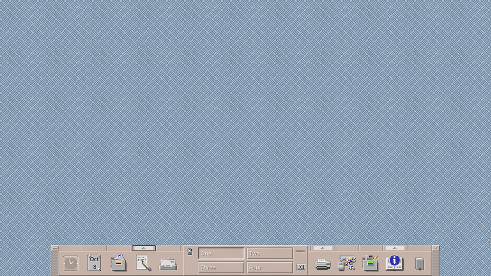

# CDE on Wayland

[](https://github.com/jmalcolm137/cde-wayland/actions/workflows/ci.yml)

Run the **Common Desktop Environment** natively on Wayland:

* Motif applications speak Wayland through
  [xlib-wayland](../xlib-wayland) — a Wayland-native, ABI-compatible `libX11`.
  No X server, no Xwayland.
* Window management and decorations come from
  [CoW](https://codeberg.org/cow-wm/cow), a stacking WM running on the
  [River](https://codeberg.org/river/river) compositor.
* Everything else is stock [CDE](https://github.com/lkujaw/cde).

See [DESIGN.md](DESIGN.md) for the architecture, the constraints of an
in-process Xlib, the CDE component strategy, and the milestone plan.

## Demo



The Workspace Menu starts the Terminal, `dtcalc` is launched from it, the File
Manager opens a text file on a double-click, and dragging `pic2.xpm` onto the
Front Panel's Icon Editor launches `dticon`.

## Try It

Start a session (needs a seat/DRM; normally from a TTY):

```sh
scripts/run-session.sh
```

Inside another Wayland session, run it nested and drive it with the smoke test:

```sh
scripts/test-nested.sh          # start + smoke-test, leaves it running
scripts/test-nested.sh --stop   # stop it
```

### Prerequisites

Arch package names; equivalents can be found on other distros.

* **Build tools** — `base-devel`, `git`, `meson`, `ninja`, `cmake`, `pkgconf`,
  `bison`, `flex`, `rpcsvc-proto` (for `rpcgen`).
* **Libraries** — `wayland`, `wayland-protocols`, `libxkbcommon`, `cairo`,
  `freetype2`, `fontconfig`, `pango`, `libxrender`, `libxcb`, `libxi`,
  `libxft`, `libpng`, `pixman`, `libbsd`, `libevent`, `libxml2`, `xorgproto`,
  `xbitmaps` (Motif needs the X bitmaps).
* **Session** — `river` (the compositor; a distro package is preferred) and a
  Wayland session, or a real seat for the DRM backend.
* **Runtime** — `ibus` is optional; `waylock` is used by the Lock Screen
  actions.

## Environment

| Variable | Default | Meaning |
|---|---|---|
| `CDE_PREFIX` | `$HOME/.local/cde-wayland` | install prefix (shim, Motif, CDE) |
| `XLIB_WAYLAND` | sibling `../xlib-wayland`, else cache | the shim checkout |
| `XLIB_WAYLAND_REPO` | `github.com/jmalcolm137/xlib-wayland` | shim upstream |
| `XLIB_WAYLAND_REF` | `main` | shim revision |
| `CDE_CACHE` | `$HOME/.cache/cde-wayland` | downloaded/cloned sources |
| `CDE_SRC` | `$CDE_CACHE/src/cde` | pristine CDE source tree |
| `CDE_BUILD` | `$CDE_PREFIX/build/cde` | CDE out-of-tree build copy |
| `COW_SRC` / `RIVER_SRC` | `$CDE_CACHE/src/cow` / `.../river` | WM + compositor sources |
| `JOBS` | `nproc` | parallel build jobs |

## License

This repository's own work is **MIT** (see [LICENSE](LICENSE)).

The overlays under `patches/` are not: each one modifies another project and
carries that project's licence instead.

* The **CDE patches** modify [CDE](https://github.com/lkujaw/cde), which is
  released under the **LGPL-2.0-or-later**. CDE's `COPYING` requires that
  modifications to it be made available under the same terms, so those patches
  are licensed the same way and carry a change notice each.
* The **CoW patches** modify [CoW](https://codeberg.org/cow-wm/cow), which is
  released under the **ISC License**; they retain the upstream notice.

See [`patches/README.md`](patches/README.md) for the full split.

No CDE or CoW source is redistributed here — the overlays are diffs, applied to
a pristine tree by `build-cde.sh` — so CDE's media clause (icons, images and
documentation under CC BY-SA 3.0, attribution "The Open Group") does not apply.
